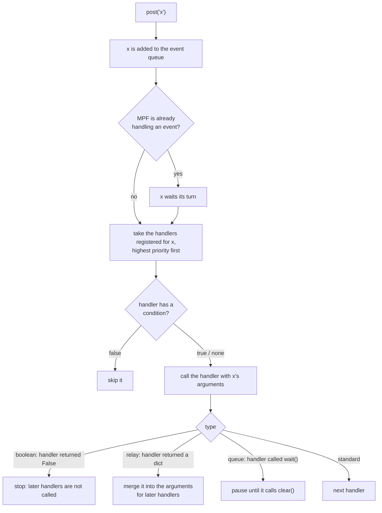

Events are how every part of MPF talks to every other part. A switch closing, a ball draining, a mode starting, a
show reaching a step: each one is an event, and everything that reacts to it is a handler for that event. This page
explains what actually happens between "an event is posted" and "my config reacted", with examples you can run.

The [events and conditions](/build/events/) guide covers the config syntax. This page is about the machinery: order,
event types, lifetimes and timing. All of it comes from `mpf/core/events.py` (`EventManager`), and every example was
run on MPF.


**Verified.** The machine at the end of this page, including its two Python files, was run on MPF 0.82.0.dev0 with
`MpfGameTestCase`. The event timeline below was recorded from that run, and `docs-site/verify/test_guides.py` repeats
every check.


## An event, up close

An event has a **name**, optional **arguments**, and a **type**. This is how `ball_started` looks in the log:

```text
INFO : EventManager : Event: ======'ball_started'====== Args={'player': 1, 'ball': 1, 'balls_remaining': 2, 'is_extra_ball': False}
```

- The name is just a string. Nobody has to declare an event before posting it, and posting one that nothing listens
  to is not an error.
- The arguments are passed to every handler. Config conditions can read them (`ball_started{ball==1}`), and custom
  code receives them as keyword arguments.
- The type decides how handlers are run: standard, boolean, relay or queue (below).

Every posted event is written to the log at INFO level, whether or not anything handles it.

## What happens when an event is posted



Step by step (`EventManager._post`, `process_event_queue` and `_run_handlers`):

1. **Posting only queues the event.** `post()` never calls handlers directly. MPF handles one event at a time.
2. **Handlers run highest priority first.** The order is fixed when the event starts; a handler added while the event
   is running does not get it.
3. **Conditions are checked per handler,** using the event's arguments merged with the handler's own (the handler's
   win on a clash).
4. **Events posted by a handler come next.** They run after the current event's handlers, but **before** events that
   were already waiting. The queue is depth-first.

### Example: depth-first order

```yaml
event_player:
  chain_a: chain_a_child
  chain_a_child: chain_a_grandchild
```

Posting `chain_a` and then `chain_b` straight after each other ran, in the test run:

```text
chain_a  ->  chain_a_child  ->  chain_a_grandchild  ->  chain_b
```

`chain_b` was posted before `chain_a_child` existed, but it waited until the whole chain started by `chain_a` was
finished. In practice: everything a single switch hit sets off is finished before the next switch hit is handled.

## Handler order

Every handler has a priority number; higher runs first. Where the number comes from:

| Handler | Priority |
|---|---|
| A config player in the machine config (`event_player:`, `show_player:`, ...) | 0 (`ConfigPlayer.register_player_events`) |
| A device's `*_events` setting in the machine config | 1 (`add_handler`'s default) |
| A config player in a mode config | the mode's `priority` (`Mode.start` passes it to each player) |
| `event_name.N` in any of these | plus N (see [handler order](/build/events/#handler-order)) |
| Custom code | whatever the code passes (`add_handler(..., priority=)`; in a mode, added to the mode's priority) |

So a mode at priority 300 sees an event before a mode at priority 100. That is what makes
[`|block`](/build/shots-and-scoring/#blocking-lower-modes) work: the higher mode's handler runs first and tells the lower
modes' handlers to skip this event. Internally the handler returns a minimum priority (`_min_priority`), and handlers
below it that belong to the same kind of player (`blocking_facility`) are skipped (`EventManager._run_handlers`).

## Four kinds of events

Most events are **standard**: every handler is called, and return values are ignored. Three other kinds let handlers
influence what happens next. You cannot choose the kind from config: the code posting the event does. Knowing which
kind an event is tells you what your config can do with it.

| Kind | What a handler can do | Built-in examples |
|---|---|---|
| standard | React. | almost everything: `ball_started`, `mode_<name>_started`, `<shot>_hit` |
| **boolean** | Return `False` to stop later handlers, and veto the action. | `request_to_start_game`, `player_add_request`, `balldevice_balls_available`, `machine_request_shutdown` |
| **relay** | Return a dict to change the arguments later handlers see. | `ball_drain`, `balldevice_<name>_ball_enter`, `ball_start_target` |
| **queue** | Call `queue.wait()` to hold the event until `queue.clear()`. | `ball_starting`, `ball_ending`, `game_starting`, `game_ending`, `player_turn_starting`, `player_turn_ending`, `mode_<name>_starting`, `mode_<name>_stopping`, `init_phase_1`..`5`, `machine_reset_phase_1`..`3` |

The table comes from the `post_boolean`, `post_relay` and `post_queue` calls in MPF's source.

### Boolean: asking for permission

When the start button is pressed, the attract mode posts `request_to_start_game` as a boolean event
(`mpf/modes/attract/code/attract.py`). The game only starts if no handler returns `False`. MPF itself uses this: the
ball controller refuses when balls are missing. Your own code can too; the `start_lock` mode at the end of this page
refuses while the coin door is open. In the test run, pressing start with `s_coin_door` active posted
`start_refused` and no game started; with the door closed the game started normally.

### Relay: passing a changing value along

`ball_drain` is a relay event with a `balls` argument: how many balls just drained. A **ball save** has a
high-priority handler that "uses up" drained balls by returning a smaller `balls` value; handlers after it see the
reduced number, and the game only ends the ball if balls are left over.

```yaml
ball_saves:
  first_save:
    active_time: 10s
    enable_events: ball_started
```

In the test run, with this ball save in the `base` mode, a drain 1 second into the ball posted `ball_drain` with
`balls: 1`; a low-priority handler on the same event saw `balls: 0`, `ball_save_first_save_saving_ball` was posted,
and the ball did not end. After the 10 seconds ran out, a drain reached the low-priority handler as `balls: 1` and the
ball ended.

### Queue: holding things up

Queue events are how MPF lets something finish before moving on: a bonus count before the next ball, a match
animation before the game ends. A handler calls `wait()`; MPF calls no further handlers for that event, and does not
continue with what comes after it, until the handler calls `clear()` (`EventManager._run_handlers_sequential`).

From config, `queue_relay_player` does this without code:

```yaml
queue_relay_player:
  ball_ending:
    post: bonus_start
    wait_for: bonus_done
```

In the test run, the ball drained, `bonus_start` was posted, and the next ball did not start until `bonus_done` was
posted, 5 seconds later in that run.


**A mode that stops at the end of the ball cannot handle `ball_ending`.** The ball ends in this order: `ball_drain`,
`ball_will_end`, then `ball_ending`. Modes with the usual `stop_events: ball_will_end` (or the default
`stop_on_ball_end: true`) have already stopped, and their handlers are gone, when `ball_ending` is posted. In the test
run, the `queue_relay_player` above did nothing when it was in the `base` mode. Put `ball_ending` handlers in the
machine config or in a mode that runs for the whole game.


## Who is listening

Handlers come from many places. All of them end up in the same table of registered handlers.

| Source | Example | Registered |
|---|---|---|
| Config players, keyed by event | `event_player: {s_target_active: ...}`, `show_player`, `variable_player`, `light_player` | while their config is active |
| Device `*_events` settings | `enable_events: ball_started` on a ball save | while the device exists |
| Mode `start_events` / `stop_events` | `start_events: ball_starting` | always (that is how a stopped mode starts) |
| Devices themselves | a ball device listening for its switches, a shot listening for its switch | while the device exists |
| Custom code | `self.add_mode_event_handler(...)` | until removed, or the mode stops |

Two rules follow:

- **Config in a mode file only listens while the mode runs.** The mode's players and devices register their handlers
  when it starts and remove them when it stops (`Mode._remove_mode_event_handlers`). See
  [modes](/build/modes/).
- **Machine config listens all the time,** including in attract mode, where there is no player. Conditions on
  `current_player` are simply false there.
- **A mode cannot react to its own start event.** Its players register only after it has started, so they would never
  see it. MPF stops with an error the first time the mode starts (not at boot; in the test run, attract mode ran
  normally and the error came when the first ball started): "skillshot mode's event_player: section contains a "ball_started:" event which is
  also in the start_events: for the skillshot mode. Change the event_player: ball_started: event name to
  "mode_skillshot_started:"" (`ConfigPlayer.register_player_events`). Use `mode_<name>_started` instead.

## A game, event by event

This is every event a one-ball-per-turn, three-ball game posted in the test run, from boot to game over, with
repetitive events left out (`machine_var_*`, `player_*` variable changes, switch events, timer ticks, ball counts).
Arguments are shown where they matter. `[q]` is a queue event, `[b]` boolean, `[r]` relay.

**Boot**

| Event | Notes |
|---|---|
| `init_phase_1` .. `init_phase_5` [q] | MPF building itself. Custom code and devices hook in here. |
| `init_done` | |
| `machine_reset_phase_1` .. `3` [q] | Reset; hardware and devices go to their start state. |
| `reset_complete` | The `start_lock` mode at the end of the page starts here. |
| `mode_attract_will_start`, `mode_attract_starting` [q], `mode_attract_started` | |
| `collecting_balls_complete` | All balls are home. |

**Press start**

| Event | Notes |
|---|---|
| `request_to_start_game` [b] | Any handler can refuse. |
| `game_start` | |
| `mode_game_will_start`, `mode_game_starting` [q], `mode_game_started` | |
| `mode_attract_will_stop`, `mode_attract_stopping` [q], `mode_attract_stopped` | Attract stops. |
| `game_will_start`, `game_starting` [q], `game_started` | |
| `player_add_request` [b], `player_adding` [q], `player_added` | `player: <Player 1>`, `num: 1` |
| `player_turn_will_start`, `player_turn_starting` [q], `player_turn_started` | |

**A ball starts**

| Event | Notes |
|---|---|
| `ball_will_start`, `ball_starting` [q] | `player: 1, ball: 1, balls_remaining: 2, is_extra_ball: False` |
| `mode_base_will_start`, `mode_base_starting` [q], `mode_base_started` | `base` starts on `ball_starting`. |
| `balls_in_play` | `balls: 1` |
| `ball_started` | Same arguments as `ball_starting`. |
| `ball_save_first_save_enabled` | The ball save's `enable_events: ball_started`. |
| `single_player_ball_started` | Only in one-player games. |
| `ball_start_target` [r] | Where the new ball goes: `target: playfield`. |
| `balldevice_balls_available` [b], `balldevice_bd_trough_ejecting_ball` | The trough ejects. |
| `playfield_active` [b], `balldevice_bd_trough_ball_eject_success`, `balldevice_playfield_ball_enter` [r] | The first playfield switch confirms the ball. |

**10 seconds later**

| Event | Notes |
|---|---|
| `ball_save_first_save_grace_period`, `ball_save_first_save_disabled` | The ball save runs out. |

**The ball drains**

| Event | Notes |
|---|---|
| `balldevice_captured_from_playfield`, `balldevice_bd_trough_ball_enter` [r] | The trough sees the ball. |
| `ball_drain` [r] | `device: bd_trough, balls: 1`. A ball save would reduce `balls` here. |
| `ball_will_end` | |
| `mode_base_will_stop`, `mode_base_stopping` [q], `mode_base_stopped` | Ball modes stop **here**. |
| `ball_ending` [q] | Held by the bonus (`bonus_counting` ... `bonus_counted`). |
| `ball_ended` | |
| `player_turn_will_end`, `player_turn_ending` [q], `player_turn_ended` | Then the next ball starts as above, with `ball: 2`. |

**After the last ball**

| Event | Notes |
|---|---|
| `ball_ended`, `player_turn_*_end*` | As above. |
| `game_will_end`, `game_ending` [q], `game_ended` | |
| `mode_game_will_stop`, `mode_game_stopping` [q] | |
| `mode_attract_will_start`, `mode_attract_starting` [q], `mode_attract_started` | Attract is back. |
| `collecting_balls_complete`, `mode_game_stopped` | |

Most of a game happens at a single instant: everything from `request_to_start_game` to the trough ejecting was posted
within the same millisecond of game time in the test run.

## Events in custom code

Config covers most needs. When it does not, a mode can have Python code. The class is named in the mode's `code:`
setting and lives in the mode's `code` folder (`code: bonus.Bonus` loads `modes/bonus/code/bonus.py`,
`ModeController._load_mode_code`).

### Adding handlers and posting events

`modes/bonus/code/bonus.py`:

```python
from mpf.core.mode import Mode


class Bonus(Mode):

    def mode_start(self, **kwargs):
        # Handlers added this way are removed automatically when the mode stops.
        self.add_mode_event_handler("s_target_active", self.target_hit)
        self.add_mode_event_handler("ball_ending", self.count_bonus)

    def target_hit(self, **kwargs):
        self.machine.events.post("bonus_advanced", source="target")

    def count_bonus(self, queue, **kwargs):
        # ball_ending is a queue event: wait() holds it until clear() is called.
        queue.wait()
        self.machine.events.post("bonus_counting")
        self.delay.add(ms=2000, callback=self.bonus_counted, queue=queue)

    def bonus_counted(self, queue):
        self.machine.events.post("bonus_counted")
        queue.clear()
```

`modes/bonus/config/bonus.yaml`:

```yaml
#config_version=6

mode:
  start_events: game_started
  stop_events: game_ended
  game_mode: false
  stop_on_ball_end: false
  code: bonus.Bonus
```

- Every handler must accept `**kwargs`; `add_handler` refuses one that does not ("Handler ... is missing **kwargs",
  checked when the handler is added).
- `post(name, **arguments)` adds arguments: `bonus_advanced` arrived with `source: "target"` in the test run.
- `self.delay` is the mode's delay manager; its delays are cancelled when the mode stops.
- The bonus mode runs for the whole game (`game_mode: false`, `stop_on_ball_end: false`) so it is still running when
  `ball_ending` is posted.

In the test run, the drain posted `ball_will_end` and `bonus_counting` at the same moment; `bonus_counted`,
`ball_ending`'s remaining handlers, `ball_ended` and the next `ball_started` all came 2 seconds later.

### Saying no to a boolean event

`modes/start_lock/code/start_lock.py`:

```python
from mpf.core.mode import Mode


class StartLock(Mode):

    def mode_start(self, **kwargs):
        self.add_mode_event_handler("request_to_start_game", self.check_start)

    def check_start(self, **kwargs):
        # request_to_start_game is a boolean event: returning False refuses the start.
        if self.machine.switches["s_coin_door"].state:
            self.machine.events.post("start_refused", reason="coin door open")
            return False
        return True
```

`modes/start_lock/config/start_lock.yaml`:

```yaml
#config_version=6

mode:
  start_events: reset_complete
  game_mode: false
  stop_on_ball_end: false
  code: start_lock.StartLock
```

### Other tools in `self.machine.events`

| Method | Use |
|---|---|
| `add_handler(event, handler, priority=1)` | Machine-wide handler; returns a key for `remove_handler_by_key(key)`. Accepts `event{condition}` and `event.N` like config. |
| `post(event, callback=None, **kwargs)` | Standard event. `callback` is called when every handler has run. |
| `post_boolean`, `post_relay`, `post_queue(event, callback)` | The other kinds. |
| `wait_for_event(name)` | An awaitable for `async` code that completes when the event is posted. |

## Watching events

- **The log.** Every event, with its arguments, at INFO level: search it for `Event: ======'` to see exactly what was
  posted and in which order.
- **Switch events need a listener.** `<switch>_active` and `sw_<tag>` are only posted when something handles them or
  the switch has `debug: true` (see [switches and coils](/build/switches-and-coils/#events-a-switch-posts)). If an
  expected switch event is missing from the log, nothing was listening yet.
- **The reference.** The [events](/reference/events/) page lists the documented events with their arguments, and
  each config reference page lists the events its device posts.

## The complete machine

`config/config.yaml`:

```yaml
#config_version=6

modes:
  - base
  - bonus
  - start_lock

machine:
  balls_installed: 1

switches:
  s_start:
    number:
    tags: start
  s_trough1:
    number:
  s_coin_door:
    number:
  s_target:
    number:
    tags: playfield_active

coils:
  c_trough_eject:
    number:

ball_devices:
  bd_trough:
    ball_switches: s_trough1
    eject_coil: c_trough_eject
    eject_targets: playfield
    tags: trough, drain, home

playfields:
  playfield:
    default_source_device: bd_trough
    tags: default

event_player:
  chain_a: chain_a_child
  chain_a_child: chain_a_grandchild

virtual_platform_start_active_switches: s_trough1
```

`modes/base/config/base.yaml`:

```yaml
#config_version=6

mode:
  start_events: ball_starting
  stop_events: ball_will_end
  priority: 100

ball_saves:
  first_save:
    active_time: 10s
    enable_events: ball_started
```

The `bonus` and `start_lock` mode files and code are above. The `queue_relay_player` example was run separately, added
to the machine config.
