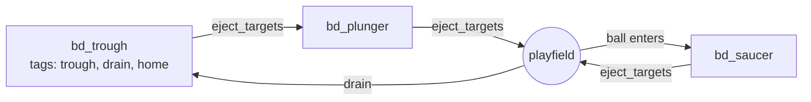

Anything that holds a ball and can let it go is a **ball device**: the trough, the plunger lane, a saucer, a vertical
up-kicker (VUK), a lock. The **playfield** is where balls go when they leave a device. This page builds a typical
machine one device at a time and explains the settings that decide how balls move.


**Verified.** The full config at the end of this page, and the three plunger variants, were run on MPF 0.82.0.dev0 with
`mpf game -X` and driven through a game with `MpfGameTestCase` on the smart virtual platform. The behavior described
under each heading is what those runs showed.


## How balls move



- A device's `eject_targets` lists where its balls can go: other ball devices or a playfield. The default is
  `playfield`.
- When a game needs a ball, the playfield asks its `default_source_device` for one. MPF follows the chain backwards:
  the plunger has no ball, so the trough ejects one into the plunger, then the plunger ejects it to the playfield.
- A ball that arrives in a device nobody asked for (a ball rolling into a saucer) is an *unexpected* ball. A device
  tagged `trough` keeps it, a device tagged `drain` sends it on to the trough, and any other device ejects it to the
  playfield it captures from (`captures_from`, default `playfield`). That is why the saucer below needs no extra
  settings to kick the ball back out.

## The trough

```yaml
switches:
  s_trough1:
    number:
  s_trough2:
    number:
  s_trough3:
    number:
  s_trough_jam:
    number:

coils:
  c_trough_eject:
    number:
    default_pulse_ms: 20

ball_devices:
  bd_trough:
    ball_switches: s_trough1, s_trough2, s_trough3, s_trough_jam
    jam_switch: s_trough_jam
    eject_coil: c_trough_eject
    eject_targets: bd_plunger
    tags: trough, drain, home
```

- **`ball_switches`** has one switch per ball position. MPF counts balls by counting active switches, so the count is
  always the real number of balls in the device.
- **`jam_switch`** is the switch above the eject position on modern troughs, where a second ball sits if two try to
  leave at once. If you set `eject_coil_jam_pulse` and the jam switch is active, the first two eject tries use that
  pulse instead of the normal one (`pulse_coil_ejector.py`).
  The jam switch is listed in `ball_switches` too, as in MPF's own trough tests
  (`test_modern_trough_plunger_setup.yaml`, `test_ball_device_jam_switch.yaml`).
- **`eject_coil`** is pulsed once per ball. The pulse length comes from the coil's `default_pulse_ms` unless you set
  `eject_times` on the device.
- **Tags** mean something to MPF here:

| Tag | Effect | Source |
|---|---|---|
| `trough` | Keeps unexpected balls instead of ejecting them. Skipped by ball search phases 2 and 3. | `ball_device.py`, `default_ball_search.py` |
| `drain` | A ball entering this device is a drain: MPF posts `ball_drain`, which ends the ball (or is absorbed by a ball save). | `ball_controller.py` |
| `home` | Where balls should rest. A game only starts when every ball is in a `home` or `trough` device (unless `game: allow_start_with_loose_balls: true`). | `ball_controller.py` |

A modern trough is all three. A machine with a separate drain (older Williams and Gottlieb designs) tags the drain
device `drain` and the trough `trough, home`; MPF's tests have examples in `test_system_11_trough.yaml` and
`test_gottlieb_trough.yaml`.

## The plunger lane

The plunger lane is a ball device with one switch. What makes the ball leave decides how you configure it. Pick one:

### Launch button (auto-launch on demand)

The ball waits in the lane until the player presses a button, then MPF fires the coil.

```yaml
switches:
  s_plunger_lane:
    number:
  s_launch:
    number:
    tags: launch

coils:
  c_plunger:
    number:
    default_pulse_ms: 30

ball_devices:
  bd_plunger:
    ball_switches: s_plunger_lane
    eject_coil: c_plunger
    player_controlled_eject_event: sw_launch
    eject_targets: playfield
    eject_timeouts: 3s
```

`player_controlled_eject_event` names the event that fires the coil. A switch tagged `launch` posts `sw_launch` when it
becomes active (`mpf/devices/switch.py`), so the tag is the easy way to connect a button. The ball waited 30 seconds
in the test run without a press; tilting also fires the coil to clear the lane.

### Manual plunger

No coil. The player pulls the plunger and MPF watches the lane switch go inactive.

```yaml
ball_devices:
  bd_plunger:
    ball_switches: s_plunger_lane
    mechanical_eject: true
    eject_targets: playfield
    eject_timeouts: 3s
```

`mechanical_eject: true` counts as an eject method, so the device needs no `eject_coil` (otherwise MPF stops with
"Device needs an eject_coil, a hold_coil, or "mechanical_eject: True"", error 4). It works only with a single ball
switch (error 5 otherwise).

### Auto-launcher

The coil fires as soon as a ball arrives in the lane. Leave out both `player_controlled_eject_event` and
`mechanical_eject`:

```yaml
ball_devices:
  bd_plunger:
    ball_switches: s_plunger_lane
    eject_coil: c_plunger
    eject_targets: playfield
    eject_timeouts: 3s
```

For a lane with both a manual plunger and a launch coil, combine `eject_coil`, `mechanical_eject: true` and
`player_controlled_eject_event` (MPF's test `test_ball_device_auto_manual_plunger.yaml`).


Only the ball served at the start of each ball is player-controlled. The game asks the playfield for it with
`player_controlled=True` (`mpf/modes/game/code/game.py`). Other balls sent through the plunger, for example during a
multiball, are launched by the coil without waiting.


## Saucers and kickers

A saucer or VUK on the playfield is a ball device whose target is the playfield:

```yaml
switches:
  s_saucer:
    number:

coils:
  c_saucer:
    number:
    default_pulse_ms: 25

ball_devices:
  bd_saucer:
    ball_switches: s_saucer
    eject_coil: c_saucer
    eject_targets: playfield
    eject_timeouts: 2s
```

With only this config, a ball that lands in the saucer is ejected straight back out (it is an unexpected ball, see
above), and MPF posts `balldevice_bd_saucer_ball_eject_success` once the ball has left. To hold the ball while
something happens (a light show, a mode starting), use a `ball_holds:` or `ball_locks:` device with the saucer in its
`hold_devices` / `lock_devices`, or turn off the automatic kick with `auto_fire_on_unexpected_ball: false`. Both are
listed in the [`ball_devices` reference](/reference/config/devices/ball-devices/).

## The playfield

```yaml
switches:
  s_left_sling:
    number:
    tags: playfield_active
  s_right_sling:
    number:
    tags: playfield_active

playfields:
  playfield:
    default_source_device: bd_plunger
    tags: default
    enable_ball_search: true
```

- **`default_source_device`** is where new balls come from. Point it at the plunger lane, not the trough, so the ball
  stops in the lane first.
- **Playfield switches.** Tag switches that only a ball on the playfield can hit (slingshots, pop bumpers, lane
  rollovers) with `playfield_active`. The tag is `<playfield name>_active`, so `playfield_active` for a playfield named
  `playfield` (`mpf/devices/playfield.py`). A hit on one confirms that the ball reached the playfield and resets the
  ball search timer.
- Without playfield switches, MPF confirms the eject when the device's **eject timeout** passes with the ball gone.
  With the 3 s timeout above, the auto-launcher run counted the ball on the playfield 3 s after launch.

### Timeouts

| Setting | Default | Meaning |
|---|---|---|
| `eject_timeouts` | 10 s | How long after the ball leaves before MPF treats the eject as confirmed, if no target confirmed it first. One value per entry in `eject_targets`. |
| `ball_missing_timeouts` | 20 s | How long before a ball that left and never arrived is treated as missing. |

Every `eject_timeouts` value must be smaller than every `ball_missing_timeouts` value (error 8). Defaults are set in
`BallDevice._validate_config` (`mpf/devices/ball_device/ball_device.py`).

### Ball search

When a ball is on the playfield but no playfield switch has been hit for a while, MPF assumes the ball is stuck and
fires coils to free it. In the test run, `ball_search_phase_1` was posted 15 s after the last switch hit.

- Ball search is **off by default**. Turn it on per playfield with `enable_ball_search: true`, or for every playfield
  with `mpf: default_ball_search: true` (default `false` in `config_spec.yaml`).
- `ball_search_timeout` (default 15 s) is the wait before searching. Phases 1 to 3 fire empty ball devices, then all
  non-trough devices with a short pulse, then with a full pulse (`default_ball_search.py`).
- What gets fired: ball devices, `autofire_coils`, `diverters`, `drop_targets`, `drop_target_banks`, `kickbacks`, and
  `flippers` with `include_in_ball_search: true`. Each has a `ball_search_order` setting.
- If every phase fails, `ball_search_failed_action` decides what happens: `new_ball` (default), `end_ball` or
  `end_game`.

## The complete config

This is the config that was run. Add a `modes:` list and your own modes as in
[Your first machine](/get-started/first-machine/).

```yaml
#config_version=6

machine:
  balls_installed: 3

switches:
  s_start:
    number:
    tags: start
  s_launch:
    number:
    tags: launch
  s_trough1:
    number:
  s_trough2:
    number:
  s_trough3:
    number:
  s_trough_jam:
    number:
  s_plunger_lane:
    number:
  s_saucer:
    number:
  s_left_sling:
    number:
    tags: playfield_active
  s_right_sling:
    number:
    tags: playfield_active

coils:
  c_trough_eject:
    number:
    default_pulse_ms: 20
  c_plunger:
    number:
    default_pulse_ms: 30
  c_saucer:
    number:
    default_pulse_ms: 25

ball_devices:
  bd_trough:
    ball_switches: s_trough1, s_trough2, s_trough3, s_trough_jam
    jam_switch: s_trough_jam
    eject_coil: c_trough_eject
    eject_targets: bd_plunger
    tags: trough, drain, home
  bd_plunger:
    ball_switches: s_plunger_lane
    eject_coil: c_plunger
    player_controlled_eject_event: sw_launch
    eject_targets: playfield
    eject_timeouts: 3s
  bd_saucer:
    ball_switches: s_saucer
    eject_coil: c_saucer
    eject_targets: playfield
    eject_timeouts: 2s

playfields:
  playfield:
    default_source_device: bd_plunger
    tags: default
    enable_ball_search: true

virtual_platform_start_active_switches: s_trough1, s_trough2, s_trough3
```

What the test run showed, in order:

1. At boot the trough counts 3 balls (`BCH: Initial count: 3` in the log), the plunger and saucer 0.
2. Start a game: the trough ejects one ball into the plunger lane. The trough has 2 balls, the plunger 1.
3. The ball stays in the lane until `s_launch` is pressed. Then the plunger fires.
4. A hit on `s_left_sling` puts the playfield count at 1.
5. A ball entering `s_saucer` is kicked back out within 2 s; the playfield count returns to 1.
6. 15 s without a switch hit starts ball search.
7. A drain into the trough ends ball 1, and ball 2 is served to the plunger lane.

## Watching it on a real machine

Set `debug: true` on a ball device to log every count and eject. Watch for these events in the log
(full list on the [events](/reference/events/) page):

- `balldevice_<name>_ball_eject_attempt`, `balldevice_<name>_ball_eject_success`, `balldevice_<name>_ball_eject_failed`
- `ball_drain`
- `playfield_ball_count_change`
- `ball_search_started`, `ball_search_phase_1` ... `ball_search_failed`
